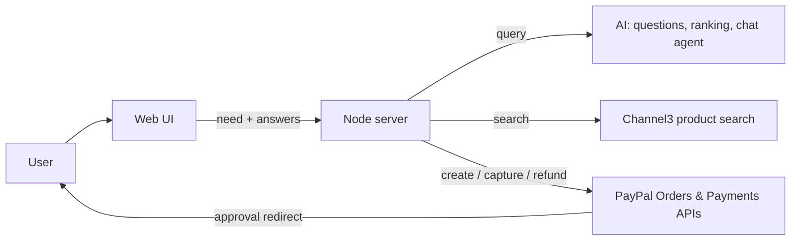

# PayAgent: an AI shopping agent that searches, recommends and checks out with PayPal

> Tell it what you want. It asks a few quick multiple-choice questions, searches real online stores, picks the best 3 products with AI, and you pay with PayPal. It can also check order status and refund.

Built for the **PayPal AI Hackathon** (agentic commerce).

**Demo video:** `<YouTube link>` · **Live demo:** "(https://payagent-q3ql.onrender.com/)"

---

## The problem

Online shopping means endless filtering, tabs and comparison. AI agents could do that work, but nobody trusts them with money. PayAgent shows a safe pattern: the AI researches and recommends, while **PayPal handles payment and the human approves it**, with a server-side budget guardrail the AI cannot override.

## How it works

1. **Ask:** "What do you want to buy?" (small talk like "hi" gets a normal reply, not a questionnaire).
2. **Guided questions:** budget, colour and 1 to 2 AI-written questions about your use case, as clear multiple-choice cards.
3. **Live search + AI ranking:** the app searches real online stores (Channel3), then the AI picks the best 3 and explains why each fits.
4. **Product cards:** real photo, price, store, features, and the "why this fits you" note.
5. **Pay with PayPal:** one click opens PayPal Sandbox checkout. After approval the server captures the payment.
6. **After purchase:** a receipt shows the items and total, and you can check status or refund the order.
7. **Orders dashboard (AG Grid):** a sortable, filterable grid of every order with PayPal status and one-click Check and Refund actions.
8. **Budget guardian:** set a monthly spending limit once (the 💰 button). Every checkout is capped to what is left, and the server blocks anything above it, so neither the AI nor a mis-click can overspend.
9. **Match scores and quantities:** each pick shows an AI match percentage, and you can choose a quantity before paying.



## PayPal + AI usage

| Piece | Used for |
|---|---|
| PayPal OAuth2 | server-side access token |
| PayPal Orders v2: create | checkout built from the chosen product |
| PayPal Orders v2: capture | after the buyer approves at PayPal |
| PayPal Orders v2: get | order status |
| PayPal Payments v2: refund | refunds by button or chat |
| AI model (OpenAI-compatible API, tested with GPT-OSS 120B on Groq; Claude also supported) | writes the extra questions, turns answers into a search query, ranks the top 3 with reasons, and runs a tool-calling chat agent (`search_products`, `create_checkout`, `order_status`, `refund_order`) |
| AG Grid Community | the Orders dashboard (sorting, filtering, pagination, action buttons) |
| Channel3 product search API | live products, images, prices and store links from online retailers |

**Agentic guardrail:** every checkout carries the user's budget. The server blocks any total above it, so the AI cannot overspend. Live product prices are re-read from the server's own saved search results, never from the browser.

**Graceful fallback:** no AI key, or no Channel3 key? The app still runs with a built-in sample catalog and rule-based ranking, so the full PayPal flow can always be tested.

## Run it locally (about 5 minutes)

Requires **Node.js 18+**. There is **nothing to install**: the project has zero dependencies.

```bash
git clone <this-repo-url>
cd payagent
cp .env.example .env      # Windows: copy .env.example .env
# edit .env (see below), then:
npm start
```

Open http://localhost:3000.

### Environment variables

| Variable | Required | Description |
|---|---|---|
| `PAYPAL_CLIENT_ID` | yes | PayPal **Sandbox** app client ID |
| `PAYPAL_CLIENT_SECRET` | yes | PayPal **Sandbox** app secret |
| `AI_BASE_URL` | for AI | OpenAI-compatible endpoint, e.g. `https://api.groq.com/openai/v1` |
| `AI_API_KEY` | for AI | API key for that provider (free tier is enough) |
| `AI_MODEL` | for AI | A tool-calling model, e.g. `openai/gpt-oss-120b` |
| `ANTHROPIC_API_KEY` | optional | Use Claude instead of the OpenAI-compatible provider |
| `CHANNEL3_API_KEY` | for live search | Channel3 key (free tier available) |
| `PORT`, `BASE_URL` | no | Defaults: `3000`, `http://localhost:3000`. Set `BASE_URL` to your public URL when hosting |

Never commit `.env`. It is listed in `.gitignore`.

### PayPal Sandbox setup

1. Go to developer.paypal.com → **Apps & Credentials** → **Sandbox** → create an app, and copy the Client ID and Secret.
2. Go to **Testing Tools → Sandbox Accounts**. You need a **Business** (seller) account for the app and a separate **Personal** (buyer) account to pay.
3. Create both accounts in the **United States** so USD payments work.
4. At checkout, log in with the **Personal** sandbox account in a private window. The seller account cannot pay itself.

## Try it (demo script)

1. Type `hi`. You get a friendly reply, not a questionnaire.
2. Type `a black pen`, then answer the questions.
3. Look at the top 3 picks with photos, features and the AI's reasons.
4. Click **Buy with PayPal**, log in with the sandbox buyer, and approve.
5. Back in the app, see **Payment successful**, then click **Check status** and **Refund this order**.
6. Open the chat bubble and type `refund ORDERID`, or try an over-budget purchase to see the guardrail block it.

## Project structure

```
server.js          # HTTP server, PayPal calls, AI helpers, Channel3 search, agent tools
public/index.html  # single-page UI (guided flow, product cards, AG Grid orders dashboard, wallet, chat widget)
.env.example       # configuration template
LICENSE            # MIT
```

API routes: `POST /api/questions`, `/api/recommend`, `/api/checkout`, `/api/status`, `/api/refund`, `/api/chat`; `GET /api/orders`, `/health`, `/return` (PayPal redirect and capture). The API is rate-limited per IP.

## Limitations (honest notes)

- Payments run only in the **PayPal Sandbox**. No real money moves, and the sandbox order is created by this app for the product's name and price. It does not purchase from the third-party store.
- Only **USD** offers are shown, because checkout is in USD.
- Orders are stored in a local JSON file, which cloud hosts with temporary disks can reset on redeploy. A production version would use a database.
- Free AI tiers have rate limits. If one is hit, wait a minute or switch to a smaller model.

## Roadmap

- Real merchant checkout handoff and affiliate-ready links
- Per-agent spending policies and approval rules
- Multi-currency checkout

## License

MIT. See [LICENSE](LICENSE).
